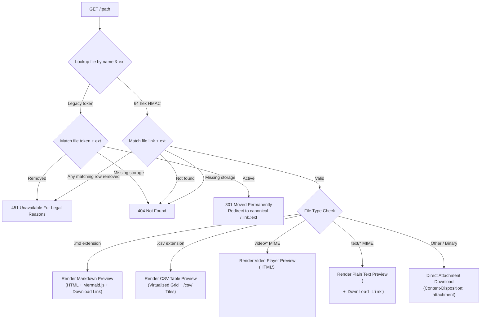

# 0x0-dockerized API

This is the HTTP API for the 0x0-dockerized file host.

---

## Overview

- Direct file uploads via `multipart/form-data` POST.
- Canonical URLs are 64-character hexadecimal HMAC-SHA256 digests. Without `FHOST_LINK_SECRET`, a guessed URL does not tell you whether a file exists.
- Legacy 12-character tokens return HTTP 301 to the canonical HMAC URL.
- Browser previews for Markdown (`.md`), CSV (`.csv`), video (`video/*`), and plain text (`text/*`).
- `/download/` keeps the original filename.
- Identical bytes, extension, and filename reuse the existing link and refresh retention.
- Retention follows a size curve. Cleanup prunes database rows and writes audit rows without IP addresses.

Base URL (local Docker): `http://localhost:8081`  
Base URL (production with TLS): `https://your-domain.example`

---

## Endpoints

### 1. Upload file

Upload a file to the service.

- **URL:** `/`
- **Method:** `POST`
- **Content-Type:** `multipart/form-data`
- **Form field:** `file` (binary or text payload)

#### Request headers
| Header | Type | Description |
|---|---|---|
| `Content-Type` | `string` | Must be `multipart/form-data; boundary=...` |

#### Request parameters
| Parameter | Location | Type | Required | Description |
|---|---|---|---|---|
| `file` | Form body | File | Yes | File content to upload. |

#### Response
- **Status:** `200 OK`
- **Content-Type:** `text/html; charset=utf-8` (or a plain URL string)
- **Body:** Canonical public URL of the uploaded file followed by a newline (`\n`).

#### Deduplication and moderation
If an upload matches an active file record (`removed=False`) with the same SHA-256 digest, extension, and original filename, the service returns the existing canonical link. If the payload is on disk, its modification time is updated (`touch`) to refresh retention. No extra database row is inserted.

If any prior upload with the derived canonical link is marked removed (`removed=True`), the re-upload is rejected with `451 Unavailable For Legal Reasons`.

#### Examples

##### Using `curl`
```bash
curl -F'file=@document.pdf' https://your-domain.example/
```
Response:
```text
https://your-domain.example/8a9f60d3d526e85bd68e7ec8d21c3b5d2e3894df051394b0ac045e7f1bc8f8c7.pdf
```

##### Using `curl` with a custom filename
```bash
curl -F'file=@report.md;filename=project-overview.md' https://your-domain.example/
```
Response:
```text
https://your-domain.example/2c7d91e604f8736a4bc294c65e8b3941459a72d61cb5e483bf9b75249cf84691.md
```

##### Using Python (`requests`)
```python
import requests

with open("example.png", "rb") as f:
    response = requests.post("https://your-domain.example/", files={"file": f})

file_url = response.text.strip()
print(f"Uploaded to: {file_url}")
```

##### Using JavaScript (`fetch`)
```javascript
const formData = new FormData();
formData.append('file', fileBlob, 'video.mp4');

const response = await fetch('https://your-domain.example/', {
  method: 'POST',
  body: formData
});

const fileUrl = (await response.text()).trim();
console.log('Uploaded to:', fileUrl);
```

---

### 2. View or preview a file

Return an uploaded file or render a browser preview from its MIME type and extension.

- **URL:** `/<link><extension>`
- **Method:** `GET`

#### URL parameters
| Parameter | Type | Description |
|---|---|---|
| `link` | `string` | 64-character hexadecimal HMAC-SHA256 link, or a legacy 12-character token. |
| `extension` | `string` | File extension matching the uploaded file (for example `.md`, `.csv`, `.mp4`, `.png`, `.txt`). |

#### Behavior by file type



1. Legacy token redirects (`301 Moved Permanently`).
   A legacy 12-character token URL is checked for removal and storage first.
   If the file is removed, the response is `451` with no redirect, so the canonical link is not revealed.
   If the file is missing from storage, the response is `404` with no redirect.
   If the file is active, the response is `301 Moved Permanently` to the canonical 64-hex URL. Query parameters are kept.

2. Markdown preview (`.md` files).
   Renders HTML from Markdown (headings, lists, blockquotes, code blocks, tables).
   `bleach` strips HTML tags and attributes that are not on the allow list, which blocks XSS.
   Mermaid diagrams in ` ```mermaid ` blocks are drawn in the browser.
   A Download link at the top points to `/download/<link><extension>`.
   Sets `X-Content-Type-Options: nosniff`.

3. CSV table preview (`.csv` files).
   Renders `csv_preview.html`.
   The grid paints only visible cells.
   Row numbers and column letters (`A`, `B`, … `AA`, and so on) are generated.
   Toolbar Row and Column boxes jump to coordinates.
   Column widths adapt. Horizontal scrolling still works.
   Headers and row numbers stay pinned. Scrolling can move by a fraction of a cell.
   Cell blocks load from `GET /csv/<link><extension>?rb=&cb=`.
   Clicking or tapping a cell opens a dialog with the full cell text from `GET /csv/<link><extension>?r=&c=`.
   A Download link at the top points to `/download/<link><extension>`.
   Sets `X-Content-Type-Options: nosniff`.

4. Video preview (`video/*` files).
   Renders a page with a native `<video controls preload="metadata">` player.
   A Download link at the top points to `/download/<link><extension>`.
   The player source is `/download/<link><extension>`, which accepts HTTP Range requests (`206 Partial Content`).
   Sets `X-Content-Type-Options: nosniff`.

5. Plain text preview (`text/*` files that are not `.md` or `.csv`).
   Renders HTML with a Download link and HTML-escaped text inside `<pre>`.
   Sets `X-Content-Type-Options: nosniff`.

6. Binary and other files (for example `.png`, `.pdf`, `.zip`, `.tar.gz`).
   Returns the bytes with `Content-Disposition: attachment; filename="<original_filename>"`.
   Sets `X-Content-Type-Options: nosniff`.

#### Example
```bash
curl -i https://your-domain.example/8a9f60d3d526e85bd68e7ec8d21c3b5d2e3894df051394b0ac045e7f1bc8f8c7.png
```
Response headers:
```http
HTTP/1.1 200 OK
Content-Type: image/png
Content-Disposition: attachment; filename="document.png"
Content-Length: 120485
X-Content-Type-Options: nosniff
```

---

### 3. Direct download (original filename)

Download any file as an attachment, skipping HTML preview pages, and keep the original uploaded filename.

- **URL:** `/download/<link><extension>`
- **Method:** `GET`

#### URL parameters
| Parameter | Type | Description |
|---|---|---|
| `link` | `string` | 64-character hexadecimal HMAC link, or a legacy 12-character token. |
| `extension` | `string` | File extension matching the uploaded record. |

#### Response headers
| Header | Value | Description |
|---|---|---|
| `Content-Type` | MIME type (for example `video/mp4`, `text/csv`, `text/markdown`) | MIME type of stored content. |
| `Content-Disposition` | `attachment; filename="<original_filename>"` | Forces a download with the original filename. |
| `X-Content-Type-Options` | `nosniff` | Stops the browser from MIME sniffing. |
| `Accept-Ranges` | `bytes` | Allows byte-range seeking for media. |

#### Example
```bash
curl -OJ https://your-domain.example/download/2c7d91e604f8736a4bc294c65e8b3941459a72d61cb5e483bf9b75249cf84691.md
```
Saves the file as `project-overview.md`.

---

### 4. CSV preview tiles and cell data

JSON for the CSV table preview. Only `.csv` files; other types return HTTP 404. Legacy tokens return 301.

- **URL:** `/csv/<link><extension>`
- **Method:** `GET`

#### Query modes

##### Tile fetch (`rb` and `cb`)
Returns a 200-row by 50-column block of cells.

- `rb`: row block index (0-indexed; `0` is rows 0–199, `1` is rows 200–399, and so on).
- `cb`: column block index (0-indexed; `0` is columns 0–49, `1` is columns 50–99, and so on).

Response format:
```json
{
  "rows": [
    ["cell_0_0", "cell_0_1", "..."],
    ["cell_1_0", "cell_1_1", "..."]
  ]
}
```

Cells longer than 50 characters are truncated with an ellipsis in the middle (for example `start…end`).

If `rb` is past the last row: `{"rows": []}`.  
If `cb` is past the last column and `rb` is in range: `N` empty lists.

##### Cell inspection (`r` and `c`)
Returns the full text of one cell after a click or tap.

- `r`: row index (0-indexed).
- `c`: column index (0-indexed).

Response format:
```json
{
  "text": "Full unabbreviated cell text content..."
}
```

If `r` or `c` is outside the sheet: `{"text": ""}`.

#### Errors and headers
Missing, negative, or non-integer query parameters return `400 Bad Request`.  
Responses include `X-Content-Type-Options: nosniff` and `Content-Type: application/json; charset=utf-8`.

---

### 5. Service landing page

Maximum upload size, retention formula, and blacklist rules in plain ASCII.

- **URL:** `/`
- **Method:** `GET`
- **Response:** `200 OK` (ASCII documentation page)

---

### 6. Search engine exclusion

Tells crawlers not to index hosted files.

- **URL:** `/robots.txt`
- **Method:** `GET`
- **Response:**
  ```text
  User-agent: *
  Disallow: /
  ```

---

## HTTP status and error codes

| Status code | Description | Reason / trigger |
|---|---|---|
| `200 OK` | Success | Upload succeeded or file/preview retrieved. |
| `206 Partial Content` | Partial content | Byte range request for media streaming. |
| `301 Moved Permanently` | Legacy redirect | Legacy 12-character token URL redirected to the canonical 64-hex HMAC link. |
| `400 Bad Request` | Bad request | Upload without a `file` multipart field, or invalid CSV tile query parameters. |
| `404 Not Found` | Not found | Link not found, extension mismatch, non-CSV file accessed via `/csv/`, or file missing on disk. |
| `411 Length Required` | Length required | Request submitted without a `Content-Length` header. |
| `413 Payload Too Large` | Payload too large | Upload exceeds `MAX_CONTENT_LENGTH`. |
| `414 URI Too Long` | URI too long | Request URL exceeds `MAX_URL_LENGTH` (4096 bytes). |
| `415 Unsupported Media Type` | Unsupported media type | Uploaded file matches `FHOST_MIME_BLACKLIST`. |
| `451 Unavailable For Legal Reasons` | Blocked content | File marked as `removed`, client IP in `FHOST_UPLOAD_BLACKLIST`, or re-upload of removed content. |

---

## Security and content policies

### Blocked MIME types (`FHOST_MIME_BLACKLIST`)
Executable payloads and active web content are rejected with HTTP 415:

- `application/xml`
- `application/xhtml+xml`
- `application/x-dosexec` (Windows/DOS executables)
- `application/java-archive` (`.jar`)
- `application/java-vm` (`.class`)
- `image/svg+xml` (SVG, which can carry inline scripts)
- `text/html` (HTML, which can carry inline scripts)

`python-magic` (`libmagic`) reads MIME type from the raw bytes, so a renamed extension does not bypass the check.

---

## Retention policy

Retention uses a non-linear cubic decay curve by file size:

$$\text{retention (days)} = 30 + (-365 + 30) \times \left(\frac{\text{file\_size}}{\text{MAX\_CONTENT\_LENGTH}} - 1\right)^3$$

- Minimum: 30 days (files at maximum upload size).
- Mid-size: about 197.5 days (files at 50% of max size).
- Maximum: 365 days (very small files).

Run `cleanup.py` to delete expired files.
