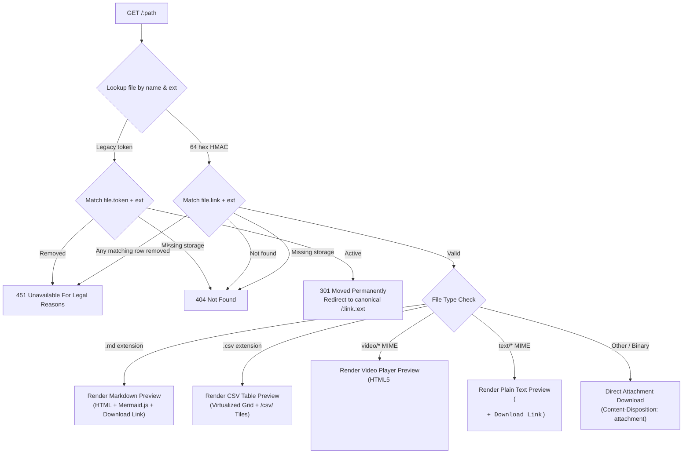

# 0x0-Dockerized API Documentation

This document provides the complete HTTP API reference for the 0x0-dockerized file hosting service.

---

## Overview

0x0-dockerized is a lightweight, hardened HTTP file hosting service. It provides:
- Direct file uploads via standard `multipart/form-data` POST requests.
- Deterministic 64-character hexadecimal HMAC-SHA256 URLs for hosted files, eliminating offline existence enumeration attacks.
- Seamless backward compatibility for legacy 12-character tokens via HTTP 301 Permanent Redirects to canonical HMAC links.
- Smart browser previews for Markdown (`.md`), CSV spreadsheets (`.csv`), Videos (`video/*`), and Plain Text (`text/*`).
- Dedicated download endpoint preserving the original uploaded filename.
- Transparent deduplication for identical uploads (matching bytes, extension, and filename) with retention refresh.
- Configurable sliding-scale file retention with automated database pruning and non-PII audit logging.

Base URL (Local Docker): `http://localhost:8081`  
Base URL (Production with TLS): `https://your-domain.example`

---

## Endpoints

### 1. Upload File

Upload a file directly to the service.

- **URL:** `/`
- **Method:** `POST`
- **Content-Type:** `multipart/form-data`
- **Form Field:** `file` (binary or text file payload)

#### Request Headers
| Header | Type | Description |
|---|---|---|
| `Content-Type` | `string` | Must be `multipart/form-data; boundary=...` |

#### Request Parameters
| Parameter | Location | Type | Required | Description |
|---|---|---|---|---|
| `file` | Form body | File | Yes | The file content to upload. |

#### Response
- **Status:** `200 OK`
- **Content-Type:** `text/html; charset=utf-8` (or plain URL string)
- **Body:** The canonical public URL of the uploaded file followed by a newline (`\n`).

#### Deduplication & Moderation Rules
- **Upload Deduplication:** If an upload matches an active file record (`removed=False`) with identical SHA-256 digest, extension, and original filename, the service returns the existing canonical link immediately. If the storage payload is present on disk, its modification timestamp is updated (`touch`) to refresh retention without creating redundant database records.
- **Moderation Rejection:** If any prior upload with the derived canonical link is marked as removed (`removed=True`), re-uploading the file is blocked immediately with `451 Unavailable For Legal Reasons`.

#### Examples

##### Using `curl`
```bash
curl -F'file=@document.pdf' https://your-domain.example/
```
**Response:**
```text
https://your-domain.example/8a9f60d3d526e85bd68e7ec8d21c3b5d2e3894df051394b0ac045e7f1bc8f8c7.pdf
```

##### Using `curl` with custom filename
```bash
curl -F'file=@report.md;filename=project-overview.md' https://your-domain.example/
```
**Response:**
```text
https://your-domain.example/2c7d91e604f8736a4bc294c65e8b3941459a72d61cb5e483bf9b75249cf84691.md
```

##### Using Python (`requests`)
```python
import requests

with open("example.png", "rb") as f:
    response = requests.post("https://your-domain.example/", files={"file": f})

file_url = response.text.strip()
print(f"Uploaded to: {file_url}")
```

##### Using JavaScript (`fetch`)
```javascript
const formData = new FormData();
formData.append('file', fileBlob, 'video.mp4');

const response = await fetch('https://your-domain.example/', {
  method: 'POST',
  body: formData
});

const fileUrl = (await response.text()).trim();
console.log('Uploaded to:', fileUrl);
```

---

### 2. View / Preview File

Retrieve an uploaded file or render its browser preview page based on its MIME type and extension.

- **URL:** `/<link><extension>`
- **Method:** `GET`

#### URL Parameters
| Parameter | Type | Description |
|---|---|---|
| `link` | `string` | 64-character hexadecimal HMAC-SHA256 link (or legacy 12-character token). |
| `extension` | `string` | File extension matching the uploaded file (e.g., `.md`, `.csv`, `.mp4`, `.png`, `.txt`). |

#### Behavior by File Type



1. **Legacy Token Redirects (`301 Moved Permanently`)**:
   - Accessing a legacy 12-character token URL evaluates removal and storage existence first.
   - If removed, it returns `451` with no redirect (preventing link discovery).
   - If missing from storage, it returns `404` with no redirect.
   - If active, it issues a `301 Moved Permanently` redirect to the canonical 64-hex URL, preserving any query parameters.

2. **Markdown Preview (`.md` files)**:
   - Renders a clean, responsive HTML document.
   - Parses Markdown syntax (headings, lists, blockquotes, code blocks, tables).
   - Sanitizes HTML tags and attributes with `bleach` to prevent XSS attacks.
   - Client-side rendering for Mermaid diagrams in ` ```mermaid ` blocks.
   - Includes a top **Download** hyperlink pointing to `/download/<link><extension>`.
   - Sets `X-Content-Type-Options: nosniff`.

3. **CSV Table Preview (`.csv` files)**:
   - Renders an interactive, responsive spreadsheet viewer (`csv_preview.html`).
   - Virtualized DOM rendering only paints visible cells, supporting large spreadsheets without browser lag.
   - Generated row numbers and column letters (`A`, `B`, … `AA`, etc.).
   - Includes interactive **Row** and **Column** finder jump boxes in the toolbar to jump directly to coordinates.
   - Responsive column width sizing that preserves horizontal scrolling.
   - Pinned headers and row numbers with smooth sub-cell scrolling.
   - Asynchronously loads cell blocks from `GET /csv/<link><extension>?rb=&cb=`.
   - Clicking/tapping any cell opens a modal dialog displaying full unabbreviated content fetched from `GET /csv/<link><extension>?r=&c=`.
   - Includes a top **Download** hyperlink pointing to `/download/<link><extension>`.
   - Sets `X-Content-Type-Options: nosniff`.

4. **Video Preview (`video/*` files)**:
   - Renders a standalone HTML page with a native `<video controls preload="metadata">` player.
   - Includes a top **Download** hyperlink pointing to `/download/<link><extension>`.
   - Streaming source points to `/download/<link><extension>` which supports HTTP Range requests (`206 Partial Content`).
   - Sets `X-Content-Type-Options: nosniff`.

5. **Plain Text Preview (`text/*` files without `.md` or `.csv`)**:
   - Renders HTML containing a top **Download** hyperlink and HTML-escaped text inside `<pre>` tags.
   - Sets `X-Content-Type-Options: nosniff`.

6. **Binary & Other Files (e.g. `.png`, `.pdf`, `.zip`, `.tar.gz`)**:
   - Returns binary content with `Content-Disposition: attachment; filename="<original_filename>"`.
   - Sets `X-Content-Type-Options: nosniff`.

#### Example
```bash
curl -i https://your-domain.example/8a9f60d3d526e85bd68e7ec8d21c3b5d2e3894df051394b0ac045e7f1bc8f8c7.png
```
**Response Headers:**
```http
HTTP/1.1 200 OK
Content-Type: image/png
Content-Disposition: attachment; filename="document.png"
Content-Length: 120485
X-Content-Type-Options: nosniff
```

---

### 3. Direct Download (Preserved Filename)

Explicitly download any file as an attachment, bypassing HTML preview pages, while preserving the original uploaded filename.

- **URL:** `/download/<link><extension>`
- **Method:** `GET`

#### URL Parameters
| Parameter | Type | Description |
|---|---|---|
| `link` | `string` | 64-character hexadecimal HMAC link (or legacy 12-char token). |
| `extension` | `string` | File extension matching the uploaded record. |

#### Response Headers
| Header | Value | Description |
|---|---|---|
| `Content-Type` | MIME type (e.g. `video/mp4`, `text/csv`, `text/markdown`) | MIME type of stored content. |
| `Content-Disposition` | `attachment; filename="<original_filename>"` | Forces file download with original filename. |
| `X-Content-Type-Options` | `nosniff` | Prevents browser MIME sniffing. |
| `Accept-Ranges` | `bytes` | Supports byte-range seeking for media streams. |

#### Example
```bash
curl -OJ https://your-domain.example/download/2c7d91e604f8736a4bc294c65e8b3941459a72d61cb5e483bf9b75249cf84691.md
```
Saves the file directly as `project-overview.md`.

---

### 4. CSV Preview Tiles & Cell Data

Provides asynchronous JSON data for the interactive CSV table preview. Supported for `.csv` files only; non-CSV files return HTTP 404. Supports legacy token 301 redirection.

- **URL:** `/csv/<link><extension>`
- **Method:** `GET`

#### Query Modes

##### 1. Tile Fetch (`rb` and `cb`)
Fetches a 200-row by 50-column block of cells.
- **Parameters:**
  - `rb`: Row block index (0-indexed; `0` = rows 0–199, `1` = rows 200–399, etc.).
  - `cb`: Column block index (0-indexed; `0` = columns 0–49, `1` = columns 50–99, etc.).
- **Response Format:**
  ```json
  {
    "rows": [
      ["cell_0_0", "cell_0_1", "..."],
      ["cell_1_0", "cell_1_1", "..."]
    ]
  }
  ```
- **Tile Truncation:** Cells exceeding 50 characters are truncated with an ellipsis in the middle (e.g. `start…end`).
- **Boundary Handling:**
  - If `rb` is beyond total rows: `{"rows": []}`.
  - If `cb` is beyond total columns (with `rb` in range): returns `N` empty lists.

##### 2. Cell Inspection (`r` and `c`)
Fetches unabbreviated text for an individual cell when clicked or tapped.
- **Parameters:**
  - `r`: Row index (0-indexed).
  - `c`: Column index (0-indexed).
- **Response Format:**
  ```json
  {
    "text": "Full unabbreviated cell text content..."
  }
  ```
- **Boundary Handling:** If `r` or `c` exceeds sheet dimensions: `{"text": ""}`.

#### Errors & Headers
- Missing, negative, or non-integer query parameters return `400 Bad Request`.
- Returns `X-Content-Type-Options: nosniff` and `Content-Type: application/json; charset=utf-8`.

---

### 5. Service Landing Page

View service information, maximum upload size, retention formula, and blacklist rules in plain ASCII format.

- **URL:** `/`
- **Method:** `GET`
- **Response:** `200 OK` (ASCII documentation page)

---

### 6. Search Engine Exclusion

Prevents web crawlers and search indexers from indexing hosted files.

- **URL:** `/robots.txt`
- **Method:** `GET`
- **Response:**
  ```text
  User-agent: *
  Disallow: /
  ```

---

## HTTP Status & Error Codes

| Status Code | Description | Reason / Trigger |
|---|---|---|
| `200 OK` | Success | Upload succeeded or file/preview retrieved. |
| `206 Partial Content` | Partial Content | Byte range request for media streaming. |
| `301 Moved Permanently` | Legacy Redirect | Legacy 12-character token URL redirected to canonical 64-hex HMAC link. |
| `400 Bad Request` | Bad Request | Upload without `file` multipart field or invalid CSV tile query parameters. |
| `404 Not Found` | Not Found | Link not found, extension mismatch, non-CSV file accessed via `/csv/`, or file missing on disk. |
| `411 Length Required` | Length Required | Request submitted without a `Content-Length` header. |
| `413 Payload Too Large` | Payload Too Large | Upload exceeds `MAX_CONTENT_LENGTH`. |
| `414 URI Too Long` | URI Too Long | Request URL exceeds `MAX_URL_LENGTH` (4096 bytes). |
| `415 Unsupported Media Type` | Unsupported Media Type | Uploaded file matches `FHOST_MIME_BLACKLIST`. |
| `451 Unavailable For Legal Reasons` | Blocked Content | File marked as `removed`, client IP in `FHOST_UPLOAD_BLACKLIST`, or re-upload attempt of removed content. |

---

## Security & Content Policies

### Blocked MIME Types (`FHOST_MIME_BLACKLIST`)
Active executable payloads and potentially dangerous web content are rejected immediately with HTTP 415:
- `application/xml`
- `application/xhtml+xml`
- `application/x-dosexec` (Windows/DOS executables)
- `application/java-archive` (`.jar`)
- `application/java-vm` (`.class`)
- `image/svg+xml` (SVG files with potential inline scripts)
- `text/html` (HTML files with potential inline scripts)

MIME type detection is performed on the raw bytes using `python-magic` (`libmagic`), preventing bypass through altered file extensions.

---

## Retention Policy

Files are retained based on file size according to a non-linear cubic decay curve:

$$\text{retention (days)} = 30 + (-365 + 30) \times \left(\frac{\text{file\_size}}{\text{MAX\_CONTENT\_LENGTH}} - 1\right)^3$$

- **Minimum Retention:** 30 days (for files at maximum upload size).
- **Mid-size Retention:** ~197.5 days (for files at 50% max size).
- **Maximum Retention:** 365 days (for very small files).

Expired files are removed by running the retention cleanup utility (`cleanup.py`).
