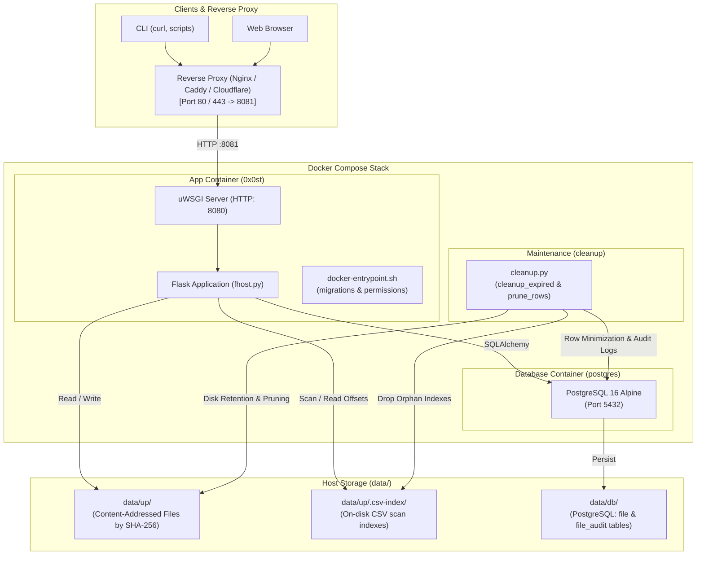
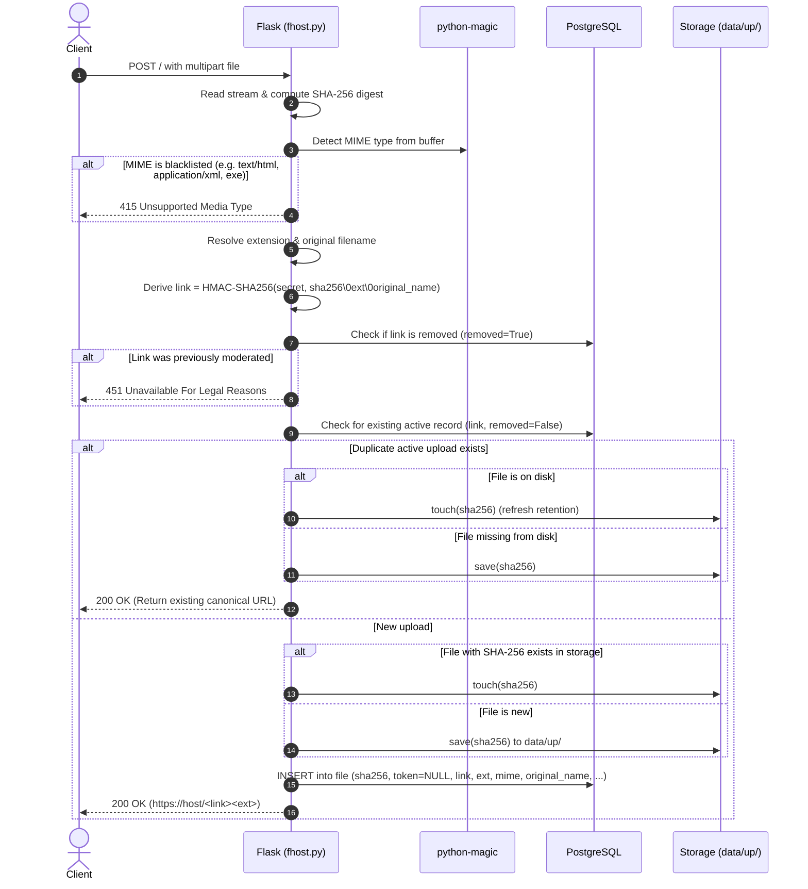

# 0x0-Dockerized Architecture Documentation

This document describes the architectural design, system boundaries, component interactions, and technical decisions of the `0x0-dockerized` project.

---

## 1. System Overview & Context

`0x0-dockerized` is a hardened, self-hosted file hosting service built on top of the `0x0` / The Null Pointer codebase. The repository wraps a Flask application in a robust Docker Compose environment.

### Primary Goals
1. **Direct File Hosting:** Enable fast, simple file uploads via `curl` and web clients.
2. **Deterministic & Privacy-Preserving URLs:** Derive 64-character hexadecimal HMAC-SHA256 canonical URLs (`FHOST_LINK_SECRET`), eliminating offline dictionary enumeration attacks while redirecting legacy 12-character tokens via HTTP 301.
3. **Rich Previews:** Provide instant browser previews for Markdown (`.md`), CSV spreadsheets (`.csv`), Video (`video/*`), and Plain Text (`text/*`) uploads without sacrificing downloadability.
4. **Filename Preservation:** Retain the original uploaded filename upon download.
5. **Security Hardening:** Reject executable/active web payloads, disable unsafe proxy/shortener features, and strictly enforce security headers.
6. **Zero-Overhead Storage & Deduplication:** Deduplicate stored payloads on disk by SHA-256 digest (`data/up/<sha256>`). Deduplicate identical uploads (same content, extension, original name) to the same canonical link while refreshing retention.
7. **Data Minimization & Compliance:** Automatically prune expired database rows, scrub IP addresses on moderated records, and maintain an append-only, zero-PII audit trail (`file_audit`).

---

## 2. High-Level Architecture

The system consists of two primary runtime services and an on-demand maintenance task managed via Docker Compose:



---

## 3. Core Subsystems & Workflows

### 3.1 Upload Flow

When a client performs a `POST /` request with multipart file data:



### 3.2 Retrieval & Preview Routing

When a client accesses `GET /<path>` or `GET /download/<path>`:

```mermaid
sequenceDiagram
    autonumber
    actor Browser
    participant Flask as Flask (fhost.py)
    participant DB as PostgreSQL
    participant FS as Storage (data/up/)

    Browser->>Flask: GET /<path>
    Flask->>Flask: Inspect path: 64-hex HMAC link or legacy token?
    alt Legacy token
        Flask->>DB: Query file by token & ext
        alt Token not found
            Flask-->>Browser: 404 Not Found
        else Token marked removed
            Flask-->>Browser: 451 Unavailable For Legal Reasons
        else Storage file missing
            Flask-->>Browser: 404 Not Found
        else Active
            Flask-->>Browser: 301 Moved Permanently (redirect to /<link><ext>)
        end
    else 64-hex HMAC link
        Flask->>DB: Query all rows matching link & ext
        alt No rows found
            Flask-->>Browser: 404 Not Found
        else Any matching row removed
            Flask-->>Browser: 451 Unavailable For Legal Reasons
        end
        Flask->>FS: Verify data/up/<sha256> exists
        alt File missing from disk
            Flask-->>Browser: 404 Not Found
        else File valid
            alt Target is .md file
                Flask->>Flask: Parse Markdown, sanitize with Bleach, inject Mermaid wrappers
                Flask-->>Browser: 200 OK (Render markdown_preview.html)
            else Target is .csv file
                Flask->>Flask: Ensure scan index exists (.csv-index/<sha256>)
                Flask-->>Browser: 200 OK (Render csv_preview.html)
                Browser->>Flask: GET /csv/<link><ext>?rb=0&cb=0 (tiles)
                Flask-->>Browser: 200 OK (JSON tile data)
            else Target is video/* MIME
                Flask-->>Browser: 200 OK (Render video_preview.html with HTML5 player)
                Browser->>Flask: GET /download/<link><ext> (video stream)
                Flask->>FS: Stream range bytes (206 Partial Content)
            else Target is text/* MIME
                Flask-->>Browser: 200 OK (Render preview.html <pre>)
            else Target is binary or /download/ requested
                Flask->>FS: Send file with Content-Disposition: attachment; filename="..."
                Flask-->>Browser: 200 OK (Attachment download)
            end
        end
    end
```

### 3.3 CSV Indexing & Virtualized Tiling

For `.csv` files, rendering large spreadsheets directly in the browser would exhaust memory and cause browser freezing. `0x0-dockerized` implements a virtualized scanning and tiling pipeline:

1. **On-Demand Indexing (`csv_index`):**
   - On the first request to `/path.csv` or `/csv/path.csv`, the file is scanned using an exclusive file lock (`fcntl.flock`).
   - An on-disk index file is written to `data/up/.csv-index/<sha256>`.
   - The index binary header stores: `total_rows` (uint64), `max_cols` (uint64), and `stopped` (uint64 flag).
   - A table of 64-bit file offsets records the byte offset of every 200th row (`CSV_BLOCK_ROWS = 200`).
   - If a line exceeds 4MB (`CSV_MAX_LINE_BYTES`), scanning halts gracefully and marks `stopped=True`, preserving rows indexed prior to the error.
2. **Virtualized DOM Grid:**
   - `csv_preview.html` initializes a lightweight virtualized viewport that draws only cells currently visible on screen.
   - Pinned row and column headers enable smooth horizontal and vertical scrolling.
   - Quick jump navigation: Toolbar inputs for Row and Column jump directly to arbitrary coordinates.
3. **Paginated JSON Tiles (`/csv/<link><ext>?rb=&cb=`):**
   - Tile requests jump directly to `offsets[rb]` on disk, avoiding sequential parsing from line 0.
   - Yields 200-row by 50-column text matrices with middle-truncated strings (`CSV_CELL_PREVIEW_CHARS = 50`).
4. **Full Cell Inspection (`/csv/<link><ext>?r=&c=`):**
   - Clicking any cell fetches the unabbreviated cell text in a modal dialog.

### 3.4 Data Minimization & Retention Cleanup

The maintenance service (`cleanup.py`) enforces privacy and data minimization in two distinct phases:

1. **Disk Retention Cleanup (`cleanup_expired`):**
   - Scans `data/up/` and computes each file's maximum retention age using the cubic decay formula.
   - Deletes expired storage payloads from disk.
   - Deletes orphaned `.csv-index` files whose corresponding SHA-256 payloads are no longer present.
2. **Database Row Pruning & PII Scrubbing (`prune_rows`):**
   - Employs a TOCTOU-reduced check: before deleting or modifying database rows, it queries disk storage with a fresh `target_file.is_file()` check.
   - **Active Expired Rows (`removed=False`):** Deletes the database records to minimize retained metadata (uploader IP, custom filenames) once storage is expired. Records `PRUNED_EXPIRED` in `file_audit`.
   - **Moderated Records (`removed=True`):** Retains minimal blocklist metadata (`sha256`, `ext`, `original_name`, `link`) to reject future re-upload attempts with HTTP 451, but immediately scrubs the uploader IP (`addr = NULL`). Records `MODERATED_ADDR_SCRUBBED` in `file_audit`.

---

## 4. Database Schema & Migration Architecture

Database state is tracked through Alembic / Flask-Migrate in `0x0/migrations/`.

```mermaid
erDiagram
    FILE {
        int id PK
        string sha256 IX
        string token "VARCHAR(32), Nullable (legacy)"
        string link "VARCHAR(64), NOT NULL, IX"
        text ext "e.g. .mp4, .md, .csv"
        text mime "e.g. text/csv, video/mp4"
        text addr "Uploader IP (scrubbed to NULL upon expiration)"
        boolean removed "Soft delete / moderation flag"
        float nsfw_score "NSFW classification score"
        text original_name "Preserved uploaded filename"
    }

    FILE_AUDIT {
        int id PK
        string sha256 IX "File SHA-256 digest"
        string link IX "HMAC link (64 hex chars)"
        string action "PRUNED_EXPIRED, MODERATED_ADDR_SCRUBBED, MODERATED"
        timestamp created_at "Timestamp of audit event"
    }

    URL {
        int id PK
        text url UK "URL string (legacy/unused in hardened mode)"
    }
```

### Partial Indexes and Token Nullability
- **`uq_file_link`:** `CREATE UNIQUE INDEX uq_file_link ON file(link) WHERE token IS NULL;`
  - Allows legacy duplicate uploads sharing the same content and filename to coexist with the same backfilled HMAC link without index collision.
  - Strictly enforces deduplication on all new uploads (`token IS NULL`).
- **`ix_file_link`:** Non-unique index on `file(link)` for fast lookups across both legacy and new uploads.
- **`ix_file_sha256`:** Index on `file(sha256)` accelerating deduplication checks, disk lookups, and `prune_rows` batch queries.

### Key Schema Evolutions
1. **Random Token Migration (`0d5b8c4b9f0d`)**: Introduced 12-character random tokens using a 64-character URL-safe alphabet, replacing sequential integer IDs.
2. **Filename Preservation Migration (`a1b2c3d4e5f6`)**: Added `original_name` column and allowed multiple distinct upload tokens to point to the same deduplicated `sha256` payload.
3. **HMAC Links & Audit Table Migration (`b2c3d4e5f6a7`)**: Added `link` column (backfilled via `FHOST_LINK_SECRET`), created `file_audit` table, indexed `sha256` and `link`, made `token` nullable, and enforced unique partial index `uq_file_link`.

---

## 5. Security Architecture

### 5.1 Defense in Depth Strategy
1. **HMAC-SHA256 Link Derivation:** Public URLs cannot be predicted or enumerated offline without knowing the server's `FHOST_LINK_SECRET`.
2. **Strict MIME Sniffing:** MIME types are detected directly from file byte content using `python-magic` (`libmagic`), ignoring user-supplied HTTP `Content-Type` headers if fraudulent.
3. **Active Web Payload Blacklist:** Rejection of HTML, XML, SVG, Java bytecode, and Windows binaries mitigates XSS, CSRF, and drive-by malware distribution.
4. **HTML Sanitization:** Markdown rendering uses `bleach` to whitelist safe HTML tags (`<p>`, `<h1>`-`<h6>`, `<code>`, `<pre>`, `<table>`, `<a>`, ``, etc.) and strip unsafe tags/scripts.
5. **Security Headers:** Every response is delivered with `X-Content-Type-Options: nosniff`. Downloads are served as attachments (`Content-Disposition: attachment`).
6. **Zero-PII Audit Logging:** The `file_audit` table logs moderation and cleanup actions without recording uploader IP addresses, query parameters, or personal data.
7. **Attack Surface Reduction:**
   - Remote URL fetching (`url=` parameter) is completely disabled to eliminate Server-Side Request Forgery (SSRF).
   - Generic URL shortening is disabled.
8. **Container Isolation:** The uWSGI server executes as an unprivileged user (`app`, UID/GID 1000). The database port (`5432`) is internal to the Docker network.

---

## 6. Key Design Decisions and Trade-offs

| Decision | Approach Chosen | Rationale | Alternatives Considered |
|---|---|---|---|
| **URL Identifiers** | Deterministic 64-hex HMAC-SHA256 links | Privacy-preserving (prevents offline existence checks), enables duplicate upload deduplication, disjoint length (64-hex vs 12-char tokens) allows unambiguous routing. | Raw SHA-256 (allows dictionary existence attacks) or random UUID/tokens (prevents deduplication). |
| **Duplicate Uploads & Partial Index** | `uq_file_link WHERE token IS NULL` | Allows existing legacy duplicate rows to share the same backfilled HMAC link without schema violation, while strictly enforcing deduplication on all new uploads. | Global unique index (fails during migration due to existing duplicate legacy tokens) or non-unique index (fails to enforce deduplication). |
| **Legacy Token Phase-Out** | HTTP 301 Permanent Redirect to 64-hex canonical URL | Preserves backwards compatibility for existing shared links and bookmarks while migrating traffic to canonical format. As legacy files expire and get pruned, legacy tokens naturally phase out completely. | Breaking existing links (poor UX) or dual lookups forever without redirection (fragmented URLs). |
| **Data Minimization** | Prune expired DB rows and scrub moderated IPs | Prevents unbounded accumulation of uploader IPs (`addr`) and filenames; converges table towards tokenless canonical schema. | Keeping DB rows forever (PII retention liability and database bloat). |
| **CSV Table Preview** | Virtualized HTML grid with on-disk scan index | Only on-screen cells are drawn; tiles come from `GET /csv/` so large sheets stay responsive. The scan index avoids re-parsing the whole file per tile. | Full in-page table or loading the entire CSV into JS (rejected: memory and DOM exhaustion on large files). |
| **Video Preview** | Native HTML5 `<video>` player pointing at `/download/` route | Zero external JS dependencies, lightweight, supports HTTP Range seeking out-of-the-box in Flask 3.1. | Video.js or CDN player (rejected: external dependency and heavier footprint). |
| **Markdown & Diagram Preview** | Server-side Python-Markdown + Bleach, client-side Mermaid.js 10.9.1 | Fast initial HTML render, strict security sanitization, diagrams rendered seamlessly on demand. | Full client-side markdown parsing or server-side puppeteer diagram rendering (heavy). |
| **Web Server Layer** | uWSGI HTTP socket mapped to host port `8081` | Simple standalone container stack, ready to sit behind any external TLS reverse proxy (Nginx, Caddy, Cloudflare, Traefik). | Built-in Nginx container in Compose (added configuration overhead when users already have a host reverse proxy). |

