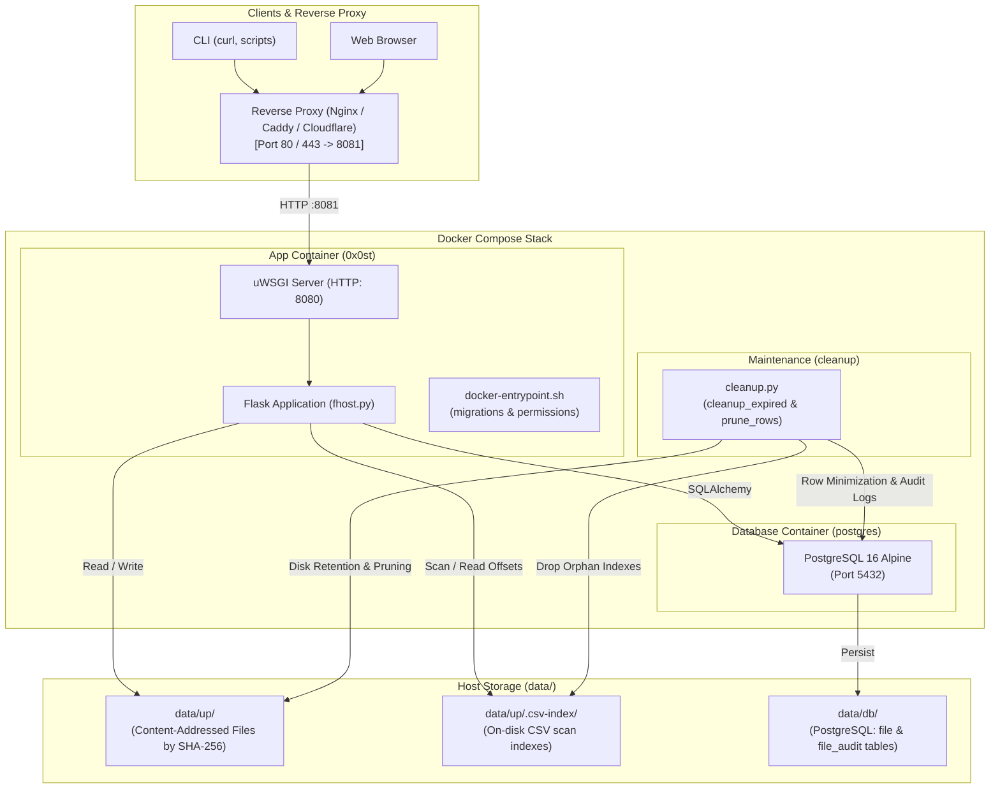
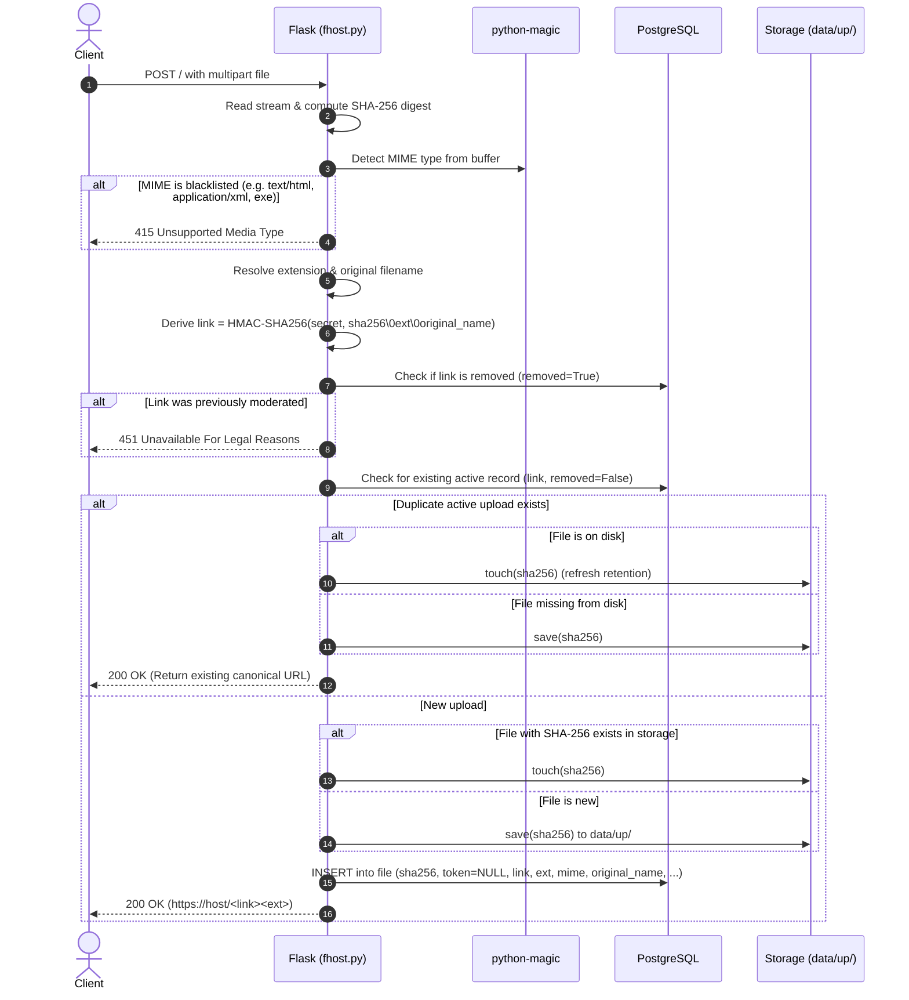

# 0x0-dockerized architecture

This file records runtime layout, request flows, schema, and security.

---

## 1. System overview

`0x0-dockerized` is a self-hosted file host based on the `0x0` / The Null Pointer codebase. A Flask app runs in Docker Compose.

### Goals
1. Accept file uploads from `curl` and browsers.
2. Derive 64-character hexadecimal HMAC-SHA256 URLs from `FHOST_LINK_SECRET`. Without the secret, a guessed URL does not tell you whether a file exists. Legacy 12-character tokens return HTTP 301.
3. Browser previews for `.md`, `.csv`, `video/*`, raster `image/*`, `application/pdf`, and `text/*`. `/download/` still returns the file. HTML, SVG, XML, and JavaScript are opaque attachments.
4. Keep the original filename on download.
5. Reject Windows executables and Java class/archive files, serve active web content as download-only, disable remote URL fetch and shortening, send `X-Content-Type-Options: nosniff`.
6. Store each payload once by SHA-256 (`data/up/<sha256>`). Same content, extension, and original name share a canonical link and refresh retention.
7. Delete expired database rows, set `addr = NULL` on moderated records, and append to `file_audit` without IP addresses.

---

## 2. High-level architecture

Docker Compose runs the app, PostgreSQL, and an on-demand cleanup task:



---

## 3. Core subsystems and workflows

### 3.1 Upload flow

When a client sends `POST /` with multipart file data:



### 3.2 Retrieval and preview routing

When a client requests `GET /<path>` or `GET /download/<path>`:

```mermaid
sequenceDiagram
    autonumber
    actor Browser
    participant Flask as Flask (fhost.py)
    participant DB as PostgreSQL
    participant FS as Storage (data/up/)

    Browser->>Flask: GET /<path>
    Flask->>Flask: Inspect path: 64-hex HMAC link or legacy token?
    alt Legacy token
        Flask->>DB: Query file by token & ext
        alt Token not found
            Flask-->>Browser: 404 Not Found
        else Token marked removed
            Flask-->>Browser: 451 Unavailable For Legal Reasons
        else Storage file missing
            Flask-->>Browser: 404 Not Found
        else Active
            Flask-->>Browser: 301 Moved Permanently (redirect to /<link><ext>)
        end
    else 64-hex HMAC link
        Flask->>DB: Query all rows matching link & ext
        alt No rows found
            Flask-->>Browser: 404 Not Found
        else Any matching row removed
            Flask-->>Browser: 451 Unavailable For Legal Reasons
        end
        Flask->>FS: Verify data/up/<sha256> exists
        alt File missing from disk
            Flask-->>Browser: 404 Not Found
        else File valid
            alt Target is .md file
                Flask->>Flask: Parse Markdown, sanitize with Bleach, inject Mermaid wrappers
                Flask-->>Browser: 200 OK (Render markdown_preview.html)
            else Target is .csv file
                Flask->>Flask: Ensure scan index exists (.csv-index/<sha256>)
                Flask-->>Browser: 200 OK (Render csv_preview.html)
                Browser->>Flask: GET /csv/<link><ext>?rb=0&cb=0 (tiles)
                Flask-->>Browser: 200 OK (JSON tile data)
            else Target is download-only MIME (HTML, SVG, XML, JavaScript)
                Flask-->>Browser: 200 OK (octet-stream attachment + CSP sandbox)
            else Target is video/* MIME
                Flask-->>Browser: 200 OK (Render video_preview.html with HTML5 player)
                Browser->>Flask: GET /download/<link><ext> (video stream)
                Flask->>FS: Stream range bytes (206 Partial Content)
            else Target is raster image/*
                Flask-->>Browser: 200 OK (Render image_preview.html)
                Browser->>Flask: GET /raw/<link><ext> (inline image)
            else Target is application/pdf
                Flask-->>Browser: 200 OK (Render pdf_preview.html sandboxed iframe)
                Browser->>Flask: GET /raw/<link><ext> (inline PDF)
            else Target is text/* MIME
                Flask-->>Browser: 200 OK (Render preview.html <pre>)
            else Target is binary or /download/ requested
                Flask->>FS: Send file with Content-Disposition: attachment; filename="..."
                Flask-->>Browser: 200 OK (Attachment download)
            end
        end
    end
```

### 3.3 CSV indexing and virtualized tiling

Loading a whole CSV into the DOM runs out of memory on large files. The preview uses an on-disk scan index and paints only on-screen cells.

1. On-demand indexing (`csv_index`).
   On the first request to `/path.csv` or `/csv/path.csv`, the file is scanned under an exclusive lock (`fcntl.flock`).
   The index is written to `data/up/.csv-index/<sha256>`.
   The binary header stores `total_rows` (uint64), `max_cols` (uint64), and `stopped` (uint64 flag).
   A table of 64-bit file offsets records the byte offset of every 200th row (`CSV_BLOCK_ROWS = 200`).
   If a line exceeds 4MB (`CSV_MAX_LINE_BYTES`), scanning stops and sets `stopped=True`. Rows indexed before that line are kept.

2. Virtualized DOM grid.
   `csv_preview.html` draws only cells currently on screen.
   Row and column headers stay pinned while the sheet scrolls.
   Toolbar inputs jump to a row or column.

3. Paginated JSON tiles (`/csv/<link><ext>?rb=&cb=`).
   A tile request seeks to `offsets[rb]` on disk instead of parsing from line 0.
   Each tile is a 200-row by 50-column text matrix. Strings longer than `CSV_CELL_PREVIEW_CHARS = 50` are truncated in the middle.

4. Full cell inspection (`/csv/<link><ext>?r=&c=`).
   Clicking a cell fetches the full cell text into a dialog.

### 3.4 Data minimization and retention cleanup

`cleanup.py` runs two phases:

1. Disk retention (`cleanup_expired`).
   Scans `data/up/` and computes each file's maximum retention age from the cubic decay formula.
   Deletes expired storage payloads.
   Deletes `.csv-index` files whose SHA-256 payload is gone.

2. Database row pruning and IP scrubbing (`prune_rows`).
   Before deleting or changing a row, it checks disk again with `target_file.is_file()` so a concurrent upload is not raced (TOCTOU).
   Active expired rows (`removed=False`): delete the database records (uploader IP, custom filenames) once storage is gone. Write `PRUNED_EXPIRED` to `file_audit`.
   Moderated records (`removed=True`): keep `sha256`, `ext`, `original_name`, and `link` so a later re-upload still gets HTTP 451. Set `addr = NULL`. Write `MODERATED_ADDR_SCRUBBED` to `file_audit`.

---

## 4. Database schema and migrations

Alembic / Flask-Migrate tracks schema in `0x0/migrations/`.

```mermaid
erDiagram
    FILE {
        int id PK
        string sha256 IX
        string token "VARCHAR(32), Nullable (legacy)"
        string link "VARCHAR(64), NOT NULL, IX"
        text ext "e.g. .mp4, .md, .csv"
        text mime "e.g. text/csv, video/mp4"
        text addr "Uploader IP (scrubbed to NULL upon expiration)"
        boolean removed "Soft delete / moderation flag"
        float nsfw_score "NSFW classification score"
        text original_name "Preserved uploaded filename"
    }

    FILE_AUDIT {
        int id PK
        string sha256 IX "File SHA-256 digest"
        string link IX "HMAC link (64 hex chars)"
        string action "PRUNED_EXPIRED, MODERATED_ADDR_SCRUBBED, MODERATED"
        timestamp created_at "Timestamp of audit event"
    }

    URL {
        int id PK
        text url UK "URL string (legacy, unused)"
    }
```

### Partial indexes and token nullability
- `uq_file_link`: `CREATE UNIQUE INDEX uq_file_link ON file(link) WHERE token IS NULL;`
  Legacy duplicate uploads that share content and filename can keep the same backfilled HMAC link without colliding.
  New uploads (`token IS NULL`) stay unique on `link`.
- `ix_file_link`: non-unique index on `file(link)` for lookups of both legacy and new uploads.
- `ix_file_sha256`: index on `file(sha256)` for deduplication checks, disk lookups, and `prune_rows` batches.

### Schema history
1. Random token migration (`0d5b8c4b9f0d`). Replaced sequential integer IDs with 12-character random tokens from a 64-character URL-safe alphabet.
2. Filename preservation migration (`a1b2c3d4e5f6`). Added `original_name`. Distinct upload tokens can point at the same `sha256` payload.
3. HMAC links and audit table migration (`b2c3d4e5f6a7`). Added `link` (backfilled with `FHOST_LINK_SECRET`), created `file_audit`, indexed `sha256` and `link`, made `token` nullable, and added unique partial index `uq_file_link`.

---

## 5. Security

### 5.1 Controls
1. HMAC-SHA256 link derivation. Public URLs cannot be predicted or listed offline without `FHOST_LINK_SECRET`.
2. MIME detection. `python-magic` (`libmagic`) reads bytes from the file. A spoofed HTTP `Content-Type` is ignored.
3. Upload vs preview vs download. Windows executables and Java class/archive files are rejected (MIME and `.exe`/`.jar`/`.class` names). HTML, SVG, XML, and JavaScript are stored and returned as `application/octet-stream` attachments with `nosniff` and a restrictive CSP. Raster images and PDFs preview from `/raw/` (`Content-Disposition: inline`); PDF preview uses a sandboxed iframe. This does not scan for malware.
4. HTML sanitization. Markdown rendering uses `bleach` to allow tags such as `<p>`, `<h1>`-`<h6>`, `<code>`, `<pre>`, `<table>`, `<a>`, and ``, and to strip scripts and other unsafe tags.
5. Security headers. Every response includes `X-Content-Type-Options: nosniff`. Downloads use `Content-Disposition: attachment`.
6. Audit logging. `file_audit` records moderation and cleanup actions. It does not store uploader IP addresses, query parameters, or other personal data.
7. Disabled features.
   Remote URL fetching (`url=` parameter) is off, which removes SSRF from that path.
   Generic URL shortening is off.
8. Container isolation. uWSGI runs as user `app` (UID/GID 1000). PostgreSQL port `5432` is internal to the Docker network.

---

## 6. Design decisions

| Decision | Approach chosen | Rationale | Alternatives considered |
|---|---|---|---|
| URL identifiers | Deterministic 64-hex HMAC-SHA256 links | Offline existence checks fail without the secret. Duplicate uploads can share a link. 64-hex vs 12-char tokens can be routed without ambiguity. | Raw SHA-256 (a known file hashes to a guessable URL) or random UUID/tokens (blocks deduplication). |
| Duplicate uploads and partial index | `uq_file_link WHERE token IS NULL` | Legacy duplicate rows can share a backfilled HMAC link. New uploads stay unique on `link`. | Global unique index (breaks the migration on existing duplicate legacy tokens) or a non-unique index (does not enforce deduplication). |
| Legacy token phase-out | HTTP 301 to the 64-hex canonical URL | Existing shared links keep working. After those files expire and are pruned, the tokens go away. | Break old links, or look up both forms forever with no redirect. |
| Data minimization | Prune expired DB rows and scrub moderated IPs | Stops unbounded growth of `addr` and filenames. The table moves toward tokenless canonical rows. | Keep DB rows forever (PII retained, table grows without bound). |
| CSV table preview | Virtualized HTML grid with on-disk scan index | Only on-screen cells are drawn. Tiles come from `GET /csv/`. The scan index avoids re-parsing the whole file per tile. | Full in-page table, or load the entire CSV into JS (memory and DOM exhaustion on large files). |
| Video preview | Native HTML5 `<video>` player pointing at `/download/` | No extra JS. Flask 3.1 `send_file` handles `Range` / `206`. | Video.js or a CDN player (extra dependency). |
| Markdown and diagram preview | Server-side Python-Markdown + Bleach, client-side Mermaid.js 10.9.1 | HTML is built on the server and sanitized. Mermaid runs in the browser for ` ```mermaid ` blocks. | Full client-side markdown parsing, or Puppeteer on the server for diagrams. |
| Web server | uWSGI HTTP socket mapped to host port `8081` | One container stack. Put Nginx, Caddy, Cloudflare, or Traefik in front for TLS. | Nginx inside Compose (extra config when a host reverse proxy already exists). |
